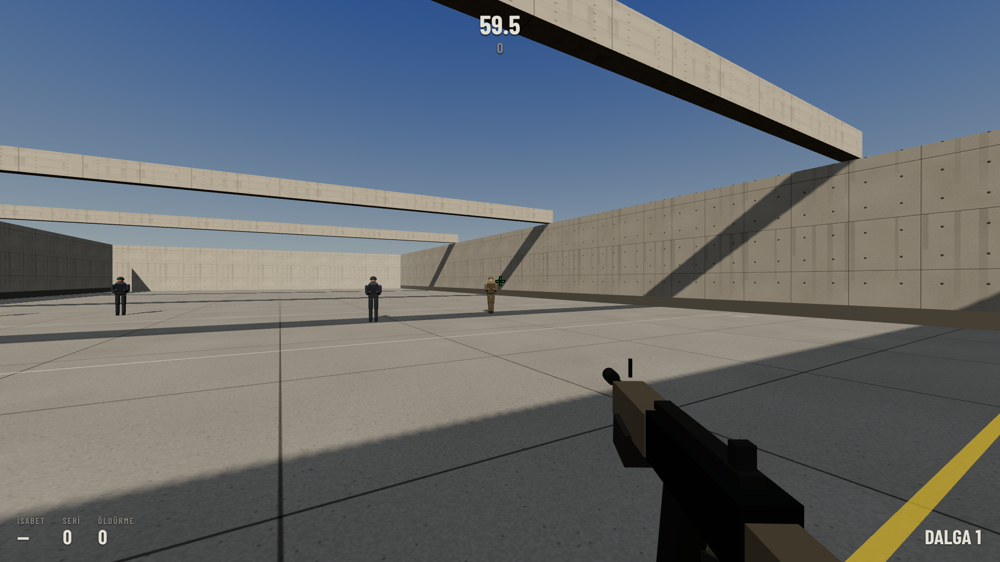
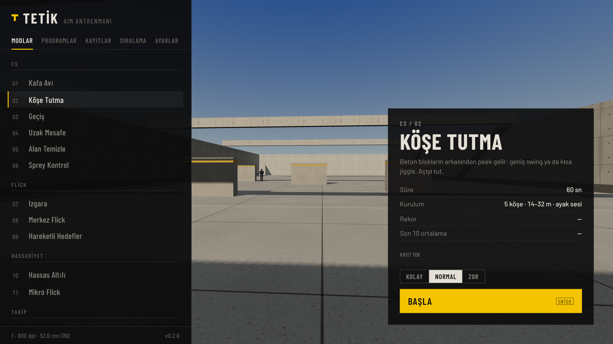

# Tetik

CS2 ayarlarıyla çalışan aim antrenmanı. Tarayıcıda, Windows'ta ve Android'de oynanır.

**Oyna:** https://etlibiftek.github.io/Counter-Striker-2-aim-trainer/
**İndir:** [Releases](../../releases/latest) (Windows `.exe`, Android `.apk`)



## CS2 ile aynı olanlar

- Hassasiyet: CS2'deki `sensitivity` değerini aynen gir (`m_yaw 0.022`). DPI'a göre
  eDPI ve 360° için gereken cm gösterilir.
- Görüş alanı: 4:3'te 90°, geniş ekranda CS2 gibi yanlara açılır.
- Nişangah: `cl_crosshairsize`, `cl_crosshairthickness`, `cl_crosshairgap`, dış çizgi,
  nokta, T şekli. CS2'deki **nişangah paylaşım kodu** (`CSGO-xxxxx-…`) ya da konsol
  komutları / `config.cfg` satırları yapıştırılarak aktarılır.
- Ölçüler: göz yüksekliği 64 birim (1.64 m), rakip 1.83 m. Kafa tek mermi, gövde iki,
  bacak üç.

## Modlar

| Grup | Mod | Ne çalıştırır |
|------|-----|---------------|
| CS | Kafa Avı | 10–32 m'de beliren, bir kısmı strafe atan rakipler |
| CS | Köşe Tutma | beton blok arkasından swing/jiggle peek, ayak sesiyle |
| CS | Geçiş | 3 m'lik boşluktan koşarak geçen rakipler |
| CS | Uzak Mesafe | 35–58 m, tek mermiyle kafa |
| CS | Alan Temizle | aynı anda 3–5 rakiplik dalgalar, temizleme süresi |
| CS | Sprey Kontrol | 30'luk şarjör, geri tepme desenini çelik hedefte telafi |
| Flick | Izgara, Merkez Flick, Hareketli Hedefler | |
| Hassasiyet | Hassas Altılı, Mikro Flick | |
| Takip | Pürüzsüz Takip, Strafe Takip | sol tık basılı, hedefte kalınan süre |
| Hız | Küçülen Hedefler, Hedef Seçimi | |
| Reaksiyon | Reaksiyon | 10 tur |

Her modun Kolay / Normal / Zor seviyesi var; rekorlar ve sıralama seviyeye göre ayrı
tutulur. **Programlar** birkaç modu arka arkaya oynatır (Isınma, CS Rutini,
Hassasiyet, Hız).

Klavye: menüde ↑↓ mod seçer, ←→ zorluğu değiştirir, Enter başlatır. Oyunda Esc
duraklatır, R baştan başlatır.

Dokunmatik ekranda iki seçenek var (Ayarlar → Gelişmiş → Dokunmatik): dokunduğun
yere ateş, ya da sürükleyerek nişan alıp ateş butonuyla atış.



## Çalıştırma

Site, Rust sunucuyla (çevrimiçi sıralama):

```sh
cargo run --release -p tetik-server   # http://localhost:8080
```

`TETIK_ADDR`, `TETIK_WEB`, `TETIK_DATA` ortam değişkenleri adres, oyun klasörü ve skor
dosyasını belirler. API: `GET /api/leaderboard?mode=kafa&difficulty=normal`,
`POST /api/scores` (skorlar sunucuda doğrulanır).

`web/` klasörü statik olarak da yayınlanabilir; o zaman sıralama tarayıcıda tutulur.
GitHub Pages "Deploy from a branch" (`main`, kök) ile yayınlanıyor: kökteki
`index.html` oyuna yönlendirir.

Masaüstü (Tauri; Windows'ta WebView2 gerekir, Windows 10/11'de hazır gelir):

```sh
cargo run --release -p tetik-desktop
cd desktop && cargo tauri build          # kurulum dosyası
```

Android (SDK, NDK 27 ve Rust Android hedefleri gerekir):

```sh
cd desktop && cargo tauri android build --apk
```

Sürüm: Actions → Release → Run workflow, etiket olarak `v0.2.0` gibi bir değer gir.
Windows ve Android dosyaları derlenip Releases'a eklenir. APK'yı sabit bir anahtarla
imzalamak için Secrets'a `ANDROID_KEYSTORE_B64` (base64 `.jks`, alias `tetik`) ve
`ANDROID_KEYSTORE_PASSWORD` eklenmeli; yoksa her sürüm geçici bir anahtarla imzalanır
ve güncellemek için eski sürümü kaldırmak gerekir.

## Yapı

```
core/      Rust: mod listesi, skor doğrulama, JSON sıralama deposu
server/    Rust: axum sunucu
desktop/   Rust: Tauri uygulaması (masaüstü + gen/android)
web/       oyun: HTML, CSS, JS (Three.js)
  js/engine.js     döngü, fare, atış, geri tepme
  js/world.js      poligon, ışık, hedef panosu, siper
  js/actors.js     hedefler ve botlar
  js/viewmodel.js  silah modeli
  js/modes.js      modlar ve programlar
  js/audio.js      sesler (WebAudio, dosyasız)
  js/crosshair.js  nişangah ve CS2 paylaşım kodu
```

Yeni mod: `web/js/modes.js` ve `core/src/lib.rs` içindeki `MODES` listesine aynı `id`
ile eklenir.

```sh
cargo test --workspace
cargo clippy --workspace --all-targets -- -D warnings
```

## Lisans

MIT. Three.js MIT (`web/vendor/THREE-LICENSE`), Barlow yazı tipi SIL OFL 1.1
(`web/fonts/OFL.txt`).
